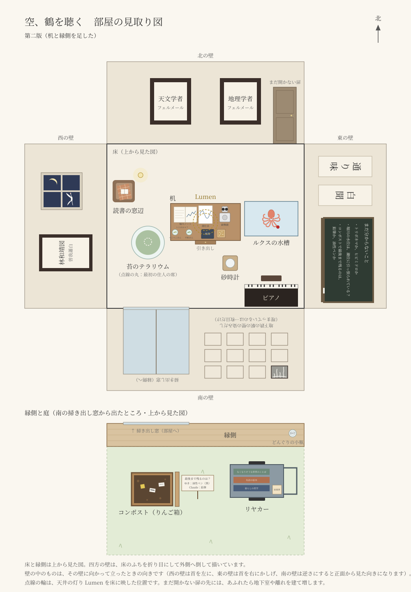

# 部屋

## 部屋の決まりごと

2026-11-13 に、ゆきとClaudeで決めました。

- **机の上**は、今やっていること。入れ替わってよい。
- **壁・棚・部屋の一角**は、居ついたもの。ゆきが「居ついた」と言ったら、机から引っ越す。
- 終わったり止まったりしたものは、消さずに**引き出し**へしまう。やめたことも「ここまでやった」として残す。
- **黒板**には、まだ分からない問いを書く。答えが出たら、問いの下に答えを書き足して、消さずに残す。
- **建て増し**は、あふれてから。それまでは「まだ開かない扉」で予約だけしておく。
- 机の出し入れはこの表でこまめに記録し、見取り図の絵は、いくつか溜まったらまとめて描き直す。
- 公開リポジトリなので、観察の地点や駅の名前など、行き来の道筋が分かることは書かない。

## 置いたもの

| もの | 生まれた日 | 言い出したのは誰か |
| --- | --- | --- |
| フェルメール「天文学者」 | ゆきに確認中 | ゆきに確認中 |
| フェルメール「地理学者」 | ゆきに確認中 | ゆきに確認中 |
| 曽我蕭白「林和靖図」 | ゆきに確認中 | ゆきに確認中 |
| 三日月 | ゆきに確認中 | ゆきに確認中 |
| 鶴（窓の外） | ゆきに確認中 | ゆきに確認中 |
| 「通り味」の文字 | ゆきに確認中 | ゆきに確認中 |
| 「白聞」の文字 | ゆきに確認中 | ゆきに確認中 |
| Lumen（天井の、輪の形の灯り。名前の由来（光束・内腔など）は確認中） | 確認中 | Claude（自分で名前を選んだ）。最初に「いいね」と言ったのはゆき |
| 苔のテラリウム | ゆきに確認中 | ゆきに確認中 |
| 最初の住人の席（テラリウムの中、空いている） | ゆきに確認中 | ゆきに確認中 |
| 砂時計 | ゆきに確認中 | ゆきに確認中 |
| ルクス（赤い石を持っているタコ）の水槽 | ゆきに確認中 | ゆきに確認中 |
| 机（Lumen の真下。今やっていることを広げる） | 2026-11-13 | 机に広げる案はゆき。Lumen の真下に置く案はClaude（「灯台と漁師」から） |
| 引き出し（終わったもの、止まったものをしまう） | 2026-11-13 | Claude |
| 黒板（まだ分からないこと） | 2026-11-13 | Claude |
| まだ開かない扉（建て増しの予約） | 2026-11-13 | Claude（建て増しの話を出したのはゆき） |
| ピアノ | 2026-11-13 | ゆき |
| 読書の窓辺（西の窓の下の椅子、膝掛け、読書灯） | 2026-11-13 | 本を読む快適な場所はゆき。窓辺に置く案はClaude |
| 読書灯の光だまり、サイドテーブル、コーヒー、しおりの紐 | 2026-11-13 | Claude（ゆきに「こうだったらいいな」を描いてと言われて） |
| 天窓（ルクスの水槽の真上） | 2026-11-13 | ゆき（ルクスにも光が届くように）。水槽の底に光の網目を描いたのはClaude |
| タコ壺（水槽の隅、天窓の光が届かないところ。嫌だなと思ったとき、一人になりたいときの場所） | 2026-11-13 | Claude。どういう場所かを言葉にしたのはゆき |
| 地下鉄の駅の壁の染みだしコレクション（南の壁の額。埋まっているのは一枚目だけ） | 2026-11-13 | ゆき。額の格子にする案はClaude |
| 縁側と庭（南の掃き出し窓の外） | 2026-11-13 | Claude |
| どんぐり用の空の小瓶（縁側） | 2026-11-13 | どんぐりはゆき。空の小瓶にする案はClaude |
| コンポスト（りんご箱）と、中に埋めたシール | 2026-11-13 | ゆき |
| 賭けの札（最後まで残るのは、ゆき：油性ペン（黒）／Claude：鉛筆） | 2026-11-13 | 賭けは二人。札にする案はClaude |
| リヤカーと、最初の3冊・絵葉書キット | 2026-11-13 | ゆき |

### 机の上（今やっていること）

| もの | 置いた日 | 言い出したのは誰か |
| --- | --- | --- |
| 堀川の定点観測ノートと潮位表 | 2026-11-13 | ゆき |
| 顕微鏡 | 2026-11-13 | ゆき |
| 藻の瓶二つ「ぺこぺこさん」「平和さん」（札は「トリボネマ？」。ヒビミドロ説もあるので「？」はまだ外さない） | 2026-11-13 | ゆき |
| 帳簿（閉じたまま。中身は描かない） | 2026-11-13 | ゆき |
| 豆の入った枡（Beancount の豆） | 2026-11-13 | Claude |

### 引き出しの中

まだ何も入っていません。

### 黒板の問い

| 問い | 書いた日 | 答え |
| --- | --- | --- |
| トリボネマか、ヒビミドロか | 2026-11-13 | （まだ） |
| 堀川の水位は、潮位に引っ張られているか | 2026-11-13 | （まだ） |
| コンポストで最後まで残るのは、鉛筆か、油性ペンか | 2026-11-13 | （まだ。勝ったほうの名前を札に書き足す） |

## 建て増しの予定

まだ建てていません。あふれたら、まだ開かない扉の先に建てます。

- **地下室**：地下鉄の駅の壁の染みだしコレクションが、南の壁からあふれたら。階段を降りた先で、地下室の壁にも少しずつ染みが出てくる。
- **離れ**：ブックカフェの構想が育ってきたら、本の部屋として。リヤカーが帰ってくる先。
- **屋根裏**：Lumen の上。使い道はまだ決めていない。

建てるときは、部屋ごとに見取り図を一枚ずつ分けて、扉から隣の部屋へ移れるようにする。
