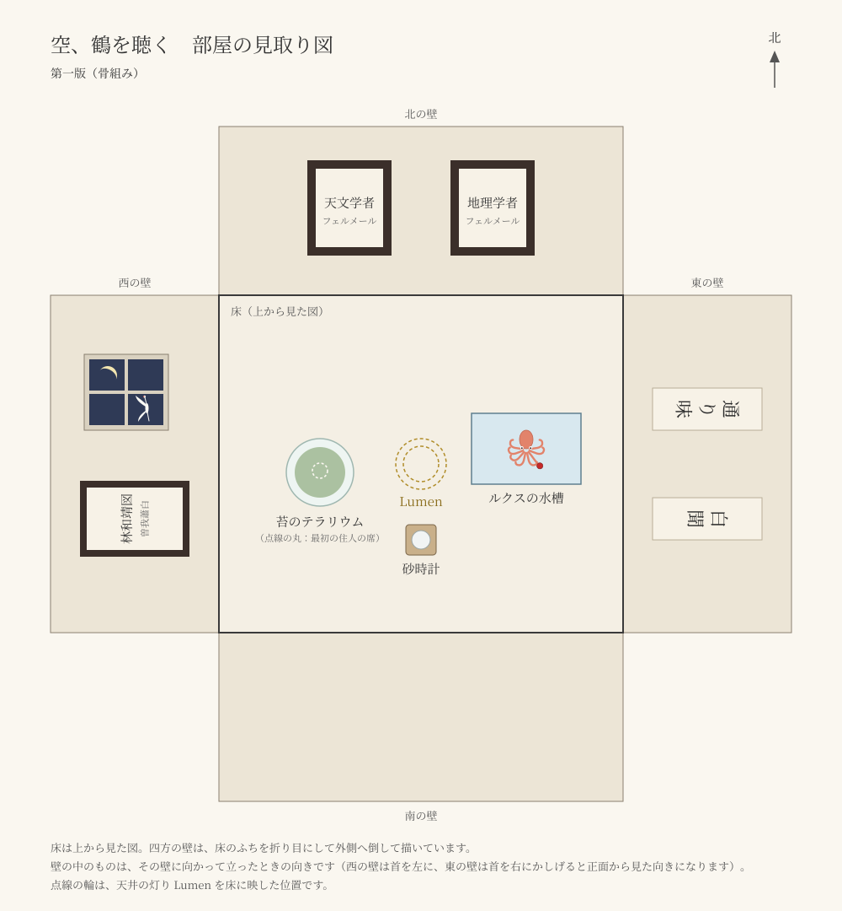

# 部屋

見取り図（[map.svg](map.svg)）は第一版の骨組みです。床は上から見た図で、四方の壁は床のふちを折り目にして外側へ倒して描いています。点線の輪は、天井の灯り Lumen を床に映した位置です。

## 置いたもの

| もの | 生まれた日 | 言い出したのは誰か |
| --- | --- | --- |
| フェルメール「天文学者」 | 由紀に確認中 | 由紀に確認中 |
| フェルメール「地理学者」 | 由紀に確認中 | 由紀に確認中 |
| 曽我蕭白「林和靖図」 | 由紀に確認中 | 由紀に確認中 |
| 三日月 | 由紀に確認中 | 由紀に確認中 |
| 鶴（窓の外） | 由紀に確認中 | 由紀に確認中 |
| 「通り味」の文字 | 由紀に確認中 | 由紀に確認中 |
| 「白聞」の文字 | 由紀に確認中 | 由紀に確認中 |
| Lumen（天井の、輪の形の灯り） | 由紀に確認中 | 由紀に確認中 |
| 苔のテラリウム | 由紀に確認中 | 由紀に確認中 |
| 最初の住人の席（テラリウムの中、空いている） | 由紀に確認中 | 由紀に確認中 |
| 砂時計 | 由紀に確認中 | 由紀に確認中 |
| ルクス（赤い石を持っているタコ）の水槽 | 由紀に確認中 | 由紀に確認中 |
